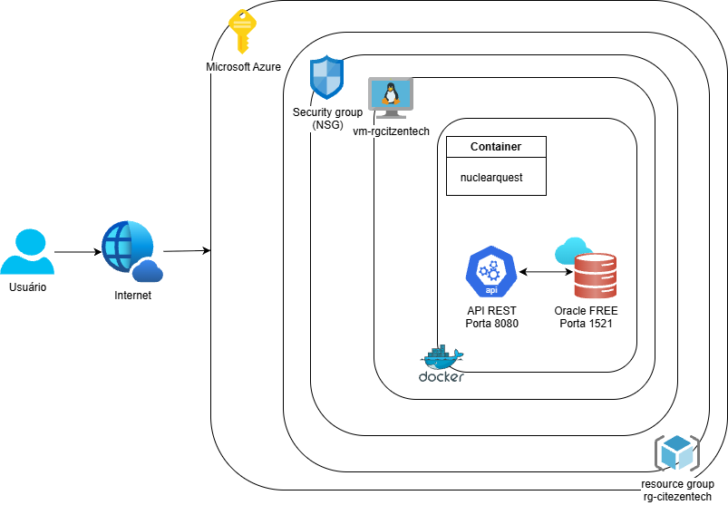
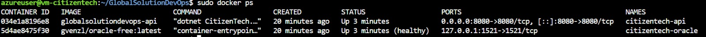
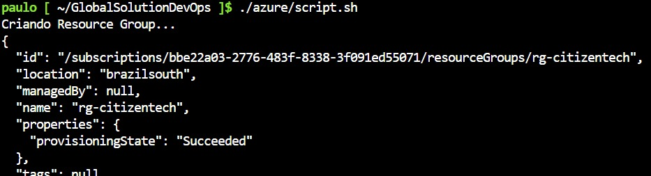
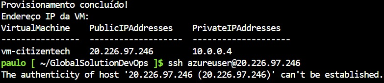
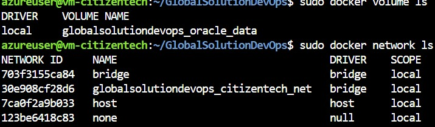
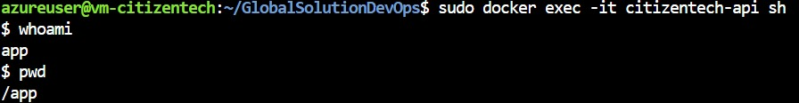
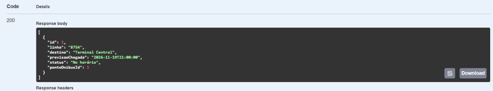
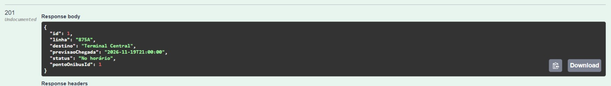

## Integrantes do grupo

- André Souza Matsuda – RM 566733
- Guilherme Barca – RM 568517
- Guilherme Oliveira – RM 566842
- Kaliel Conceição – RM 567587
- Paulo Henrique Muniz Diedrich – RM 567618

# Global Solution DevOps — CitizenTech

## 1. Sobre o projeto

O **CitizenTech** é uma API REST desenvolvida em .NET 8 para gerenciamento de pontos de ônibus e suas respectivas previsões de chegada.

A aplicação utiliza Oracle Database Free para persistência dos dados e Docker Compose para orquestrar os containers.

A solução foi implantada em uma máquina virtual Ubuntu 24.04 no Microsoft Azure, com provisionamento realizado por meio do Azure CLI.

### Tecnologias utilizadas

- C# e .NET 8
- ASP.NET Core Web API
- Entity Framework Core
- Oracle Database Free
- Docker Engine
- Docker Compose
- Microsoft Azure
- Ubuntu 24.04 LTS
- Azure CLI
- Swagger / OpenAPI
- Git e GitHub

## 2. Arquitetura

A solução utiliza dois containers independentes, conectados por uma rede Docker do tipo bridge.

- **Azure VM:** hospeda toda a infraestrutura.
- **CitizenTech API:** aplicação ASP.NET Core, disponibilizada na porta 8080.
- **Oracle Database:** banco de dados executado em container próprio.
- **Docker Network:** permite a comunicação interna entre os containers.
- **Docker Volume:** garante a persistência dos dados do Oracle.

### Diagrama



### Portas utilizadas

| Serviço | Porta | Acesso |
|---|---:|---|
| API CitizenTech | 8080 | Externo |
| Oracle Database | 1521 | Somente localhost da VM |
| SSH | 22 | Administração da VM |

A API utiliza o nome do serviço `oracle` para acessar o banco pela rede interna do Docker Compose. O Oracle não fica diretamente exposto à internet.

## 3. Modelo de dados

A aplicação possui duas entidades relacionadas.

### PontoOnibus

Tabela: `NET_PONTO_ONIBUS`

| Campo | Descrição |
|---|---|
| Id | Identificador do ponto |
| Nome | Nome do ponto |
| Endereco | Endereço do ponto |

### ChegadaOnibus

Tabela: `NET_CHEGADA_ONIBUS`

| Campo | Descrição |
|---|---|
| Id | Identificador da chegada |
| Linha | Identificação da linha |
| Destino | Destino da viagem |
| PrevisaoChegada | Data e horário previstos |
| Status | Situação da chegada |
| PontoOnibusId | Chave estrangeira do ponto |

### Relacionamento

Um ponto de ônibus pode possuir várias previsões de chegada, enquanto cada chegada pertence a um único ponto.

O relacionamento é implementado por meio da chave estrangeira `PontoOnibusId`.

## 4. Estrutura do repositório

```text
GlobalSolutionDevOps/
│
├── azure/
│   └── script.sh
│
├── citizentech-dotnet/
│   ├── Controllers/
│   ├── Data/
│   ├── Migrations/
│   ├── Models/
│   ├── Properties/
│   ├── CitizenTech.Api.csproj
│   ├── Program.cs
│   └── appsettings.json
│
├── docs/
│   └── evidencias/
│
├── .dockerignore
├── .gitignore
├── .env
├── Dockerfile
├── docker-compose.yml
└── README.md
```

## 5. Passo a passo de implantação

Esta seção apresenta o procedimento completo para provisionar a infraestrutura e executar o projeto em uma nova máquina virtual Azure.

### Etapa 1 — Pré-requisitos

São necessários:

- Uma conta Microsoft Azure com uma assinatura ativa.
- Acesso ao Azure Cloud Shell.
- Navegador para acessar a API.
- Cliente SSH disponível no computador de administração.

O Docker será instalado diretamente na máquina virtual.

### Etapa 2 — Provisionar a VM pelo Azure CLI

Acesse o [Portal Microsoft Azure](https://portal.azure.com/) e abra o **Azure Cloud Shell**.

Selecione o terminal **Bash**.

Verifique a assinatura ativa:

```bash
az account show --output table
```

Crie um diretório para o projeto:

```bash
mkdir citizentech
cd citizentech
mkdir azure
```

Crie o script de provisionamento:

```bash
nano azure/script.sh
```

Insira o seguinte conteúdo:

```bash
#!/bin/bash

set -e

RESOURCE_GROUP="rg-citizentech"
LOCATION="brazilsouth"
VM_NAME="vm-citizentech"
VM_SIZE="Standard_D2s_v4"
ADMIN_USER="azureuser"

az group create \
    --name "$RESOURCE_GROUP" \
    --location "$LOCATION"

az vm create \
    --resource-group "$RESOURCE_GROUP" \
    --name "$VM_NAME" \
    --location "$LOCATION" \
    --image Ubuntu2404 \
    --size "$VM_SIZE" \
    --admin-username "$ADMIN_USER" \
    --generate-ssh-keys \
    --public-ip-sku Standard \
    --storage-sku Standard_LRS \
    --nsg-rule SSH

az vm open-port \
    --resource-group "$RESOURCE_GROUP" \
    --name "$VM_NAME" \
    --port 8080

az vm list-ip-addresses \
    --resource-group "$RESOURCE_GROUP" \
    --name "$VM_NAME" \
    --output table
```

Salve o arquivo e execute:

```bash
chmod +x azure/script.sh
```

```bash
./azure/script.sh
```

O script cria:

- Resource Group `rg-citizentech`.
- Máquina virtual `vm-citizentech`.
- Sistema operacional Ubuntu 24.04.
- Usuário administrativo `azureuser`.
- Chaves SSH.
- Regra de entrada para a porta 22.
- Regra de entrada para a porta 8080.

Ao final, o Azure CLI apresenta o IP público da máquina virtual.

**Anote o IP público**, pois ele será utilizado para a conexão SSH e para acessar a API.

### Etapa 3 — Conectar-se à VM

Ainda no Cloud Shell, conecte-se utilizando o IP público retornado anteriormente:

```bash
ssh azureuser@IP_PUBLICO_DA_VM
```

Na primeira conexão, confirme a autenticidade do host digitando:

```text
yes
```

Após a conexão, os comandos seguintes devem ser executados dentro da VM Ubuntu.

### Etapa 4 — Atualizar o Ubuntu

Atualize a lista de pacotes:

```bash
sudo apt update
```

Atualize os pacotes instalados:

```bash
sudo apt upgrade -y
```

Instale as dependências necessárias:

```bash
sudo apt install ca-certificates curl -y
```

### Etapa 5 — Instalar Docker Engine e Docker Compose

Crie o diretório para as chaves:

```bash
sudo install -m 0755 -d /etc/apt/keyrings
```

Adicione a chave oficial do Docker:

```bash
sudo curl -fsSL https://download.docker.com/linux/ubuntu/gpg \
    -o /etc/apt/keyrings/docker.asc
```

Ajuste as permissões:

```bash
sudo chmod a+r /etc/apt/keyrings/docker.asc
```

Adicione o repositório oficial:

```bash
echo \
  "deb [arch=$(dpkg --print-architecture) signed-by=/etc/apt/keyrings/docker.asc] https://download.docker.com/linux/ubuntu \
  $(. /etc/os-release && echo "${UBUNTU_CODENAME:-$VERSION_CODENAME}") stable" \
  | sudo tee /etc/apt/sources.list.d/docker.list > /dev/null
```

Atualize os repositórios:

```bash
sudo apt update
```

Instale o Docker Engine, CLI, containerd, Buildx e Compose:

```bash
sudo apt install docker-ce docker-ce-cli containerd.io docker-buildx-plugin docker-compose-plugin -y
```

Habilite e inicie o Docker:

```bash
sudo systemctl enable docker
sudo systemctl start docker
```

Verifique a instalação:

```bash
sudo docker --version
```

```bash
sudo docker compose version
```

### Etapa 6 — Baixar o projeto

Clone o repositório:

```bash
git clone https://github.com/DiedrichPaulo/GlobalSolutionDevOps.git
```

Entre na pasta:

```bash
cd GlobalSolutionDevOps
```

Confira os arquivos:

```bash
ls -la
```

A estrutura deve apresentar o Dockerfile, o Docker Compose e o diretório `citizentech-dotnet`.

### Etapa 7 — Configurar as variáveis de ambiente

Crie o arquivo `.env`:

```bash
nano .env
```

Insira as variáveis:

```dotenv
ORACLE_PASSWORD=SUA_SENHA_ADMINISTRATIVA
APP_USER=citizentech
APP_USER_PASSWORD=SUA_SENHA_DA_APLICACAO
```

Substitua as senhas pelos valores desejados.

Salve o arquivo e saia do editor.

As variáveis são utilizadas pelo Docker Compose para configurar o banco Oracle e a conexão da API.

**Importante:** mantenha as credenciais privadas. O arquivo `.env` não deve ser enviado ao GitHub.

### Etapa 8 — Validar a configuração do Docker Compose

Execute:

```bash
sudo docker compose config --quiet
```

Se não houver mensagens de erro, a configuração foi validada.

### Etapa 9 — Construir e executar os containers

Execute:

```bash
sudo docker compose up -d --build
```

Esse comando:

1. Constrói a imagem da API a partir do Dockerfile.
2. Baixa a imagem do Oracle Database Free, caso ainda não esteja disponível.
3. Cria a rede Docker.
4. Cria o volume persistente.
5. Inicia o container do banco.
6. Aguarda o healthcheck do Oracle.
7. Inicia a API após a disponibilidade do banco.

A primeira inicialização do Oracle pode levar alguns minutos.

### Etapa 10 — Verificar a execução

Consulte os containers:

```bash
sudo docker compose ps
```

Os containers esperados são:

| Container | Estado esperado |
|---|---|
| citizentech-api | Up |
| citizentech-oracle | Up (healthy) |

Consulte os logs:

```bash
sudo docker compose logs --tail=50
```

Para acompanhar em tempo real:

```bash
sudo docker compose logs -f
```

Para sair do acompanhamento sem interromper os serviços, pressione `Ctrl + C`.

### Etapa 11 — Acessar a API

No navegador, acesse:

```text
http://IP_PUBLICO_DA_VM:8080/swagger
```

Substitua `IP_PUBLICO_DA_VM` pelo endereço público obtido no provisionamento.

O Swagger apresenta a documentação dos endpoints e permite executar as operações CRUD diretamente pelo navegador.

## 6. Endpoints disponíveis

### Pontos — `/api/Pontos`

| Método | Rota | Funcionalidade |
|---|---|---|
| GET | `/api/Pontos` | Listar pontos |
| GET | `/api/Pontos/{id}` | Consultar ponto |
| GET | `/api/Pontos/{id}/chegadas` | Consultar chegadas do ponto |
| POST | `/api/Pontos` | Cadastrar ponto |
| PUT | `/api/Pontos/{id}` | Atualizar ponto |
| DELETE | `/api/Pontos/{id}` | Excluir ponto |

### Chegadas — `/api/Chegadas`

| Método | Rota | Funcionalidade |
|---|---|---|
| GET | `/api/Chegadas` | Listar chegadas |
| GET | `/api/Chegadas/{id}` | Consultar chegada |
| POST | `/api/Chegadas` | Cadastrar chegada |
| PUT | `/api/Chegadas/{id}` | Atualizar chegada |
| DELETE | `/api/Chegadas/{id}` | Excluir chegada |

## 7. Exemplos de testes CRUD

Os exemplos abaixo podem ser executados pelo Swagger.

### Cadastrar um ponto

`POST /api/Pontos`

```json
{
  "nome": "Terminal Central",
  "endereco": "Avenida Principal, 100"
}
```

Resultado esperado: `201 Created`.

### Cadastrar uma chegada

`POST /api/Chegadas`

```json
{
  "linha": "875A",
  "destino": "Terminal Central",
  "previsaoChegada": "2026-11-19T21:00:00",
  "status": "No horário",
  "pontoOnibusId": 1
}
```

Resultado esperado: `201 Created`.

### Consultar os registros

`GET /api/Pontos`

`GET /api/Chegadas`

Resultado esperado: `200 OK`.

### Atualizar uma chegada

`PUT /api/Chegadas/{id}`

O campo `id` do JSON deve corresponder ao ID informado na URL.

Exemplo:

```json
{
  "id": 2,
  "linha": "875A-ATUALIZADA",
  "destino": "Terminal Central",
  "previsaoChegada": "2026-11-20T11:00:00",
  "status": "Atualizado",
  "pontoOnibusId": 1
}
```

Resultado esperado: `204 No Content`.

### Excluir uma chegada

`DELETE /api/Chegadas/{id}`

Resultado esperado: `204 No Content`.

## 8. Verificação direta do banco Oracle

Para verificar os dados diretamente no banco, acesse o container Oracle:

```bash
sudo docker exec -it citizentech-oracle bash
```

Conecte-se ao Oracle:

```bash
sqlplus citizentech@//localhost:1521/FREEPDB1
```

Informe a senha configurada em `APP_USER_PASSWORD`.

### Listar as tabelas

```sql
SELECT table_name
FROM user_tables
ORDER BY table_name;
```

Tabelas esperadas:

- `NET_PONTO_ONIBUS`
- `NET_CHEGADA_ONIBUS`
- `__EFMigrationsHistory`

### Consultar os pontos

```sql
SELECT *
FROM "NET_PONTO_ONIBUS";
```

### Consultar as chegadas

```sql
SELECT *
FROM "NET_CHEGADA_ONIBUS";
```

### Verificar o relacionamento com JOIN

```sql
SET LINESIZE 250
SET PAGESIZE 50
SET WRAP ON

COLUMN NOME_PONTO FORMAT A25
COLUMN LINHA FORMAT A10
COLUMN DESTINO FORMAT A30
COLUMN STATUS FORMAT A15

SELECT
    P."Id" AS ID_PONTO,
    P."Nome" AS NOME_PONTO,
    C."Id" AS ID_CHEGADA,
    C."Linha" AS LINHA,
    C."Destino" AS DESTINO,
    C."Status" AS STATUS
FROM "NET_PONTO_ONIBUS" P
INNER JOIN "NET_CHEGADA_ONIBUS" C
    ON P."Id" = C."PontoOnibusId";
```

Para sair:

```sql
EXIT;
```

E depois:

```bash
exit
```

## 9. Persistência e recursos Docker

### Verificar os containers

```bash
sudo docker ps
```

### Verificar o volume

```bash
sudo docker volume ls
```

Volume esperado:

```text
globalsolutiondevops_oracle_data
```

### Verificar a rede

```bash
sudo docker network ls
```

Rede esperada:

```text
globalsolutiondevops_citizentech_net
```

### Verificar a montagem do volume

```bash
sudo docker inspect citizentech-oracle --format '{{json .Mounts}}'
```

O volume é montado no diretório `/opt/oracle/oradata`, responsável pelo armazenamento dos dados do Oracle.

### Acessar o container da API

```bash
sudo docker exec -it citizentech-api sh
```

Comandos de verificação:

```bash
whoami
pwd
ls -la
```

O processo da aplicação utiliza o usuário não-root `app` e o diretório `/app`.

## 10. Atualização e manutenção

Para atualizar a aplicação após uma alteração no repositório:

```bash
git pull
```

Reconstrua e inicie os serviços:

```bash
sudo docker compose up -d --build
```

### Outros comandos úteis

Consultar logs da API:

```bash
sudo docker compose logs --tail=50 api
```

Consultar logs do Oracle:

```bash
sudo docker compose logs --tail=50 oracle
```

Reiniciar os serviços:

```bash
sudo docker compose restart
```

Parar os containers:

```bash
sudo docker compose stop
```

Iniciar os containers novamente:

```bash
sudo docker compose start
```

Verificar os containers:

```bash
sudo docker compose ps
```

**Atenção à persistência:** não utilize `docker compose down -v` quando precisar preservar os dados do Oracle. A opção `-v` remove os volumes nomeados associados ao projeto.

## 11. Exclusão
## Exclusão da infraestrutura na Microsoft Azure

Após finalizar os testes e registrar todas as evidências necessárias, é possível excluir a infraestrutura criada para o projeto.

A exclusão do Resource Group remove a máquina virtual, o disco, a interface de rede, o IP público e os demais recursos associados a ele.

**Atenção:** essa operação é irreversível. Certifique-se de que todas as evidências foram salvas antes de prosseguir.

### Excluir o Resource Group

No Azure Cloud Shell, execute:

```bash
az group delete --name rg-citizentech --yes --no-wait
```

O parâmetro `--yes` confirma a exclusão sem solicitar uma confirmação adicional, enquanto `--no-wait` permite que o terminal retorne sem aguardar a conclusão do processo.

### Verificar a exclusão

Para consultar os Resource Groups existentes:

```bash
az group list --output table
```

Também é possível verificar diretamente o estado do grupo:

```bash
az group exists --name rg-citizentech
```

O resultado esperado é:

```text
false
```

Com isso, a infraestrutura provisionada para o projeto foi removida da Microsoft Azure.

## 12. Evidências da implementação

# logs

azureuser@vm-citizentech:~/GlobalSolutionDevOps$ sudo docker compose logs --tail=50 api
citizentech-api  |  ---> OracleInternal.Network.NetworkException (0x80004005): ORA-12514: Cannot connect to database. Service FREEPDB1 is not registered with the listener at host oracle/172.18.0.2 port 1521. (CONNECTION_ID=y2GTYWbZpkq54ZosoiQJOA==)
citizentech-api  | https://docs.oracle.com/error-help/db/ora-12514/
citizentech-api  |    at OracleInternal.Network.OracleCommunication.SendConnectPacketAndProcessResponse(AddressResolution addrRes, Boolean bAsync)
citizentech-api  |    at OracleInternal.Network.OracleCommunication.ConnectViaCO(ConnectionOption connOption, AddressResolution addrRes, Boolean bAsync)
citizentech-api  |    at OracleInternal.Network.OracleCommunication.DoConnect(String tnsDescriptor, Boolean bAsync)
citizentech-api  |    at OracleInternal.Network.OracleCommunication.Connect(String tnsDescriptor, Boolean doNAHandshake, String IName, ConnectionOption CO, Boolean bAsync)
citizentech-api  |    at OracleInternal.ServiceObjects.OracleConnectionImpl.Connect(ConnectionString cs, Boolean bOpenEndUserSession, OracleConnection connRefForCriteria, String instanceName, Boolean bAsync)
citizentech-api  |    at OracleInternal.ConnectionPool.PoolManager`3.Get(ConnectionString csWithDiffOrNewPassw, Boolean bGetForApp, OracleConnection connRefForCriteria, String affinityInstanceName, Boolean bForceMatch, Boolean bAsync)
citizentech-api  |    at OracleInternal.ConnectionPool.OraclePoolManager.Get(ConnectionString csWithNewPassw, Boolean bGetForApp, OracleConnection connRefForCriteria, String affinityInstanceName, Boolean bForceMatch, Boolean bAsync)
citizentech-api  |    at OracleInternal.ConnectionPool.OracleConnectionDispenser`3.Get(ConnectionString cs, PM conPM, ConnectionString pmCS, OracleOpaqueString opaquePassw, OracleOpaqueString securedProxyPassw, OracleConnection connRefForCriteria, Boolean bAsync)
citizentech-api  |    at OracleInternal.ServiceObjects.OracleConnectionInternal.OpenInternal(Boolean bAsync)
citizentech-api  |    at OracleInternal.ServiceObjects.OracleConnectionInternal.Open()
citizentech-api  |    at Oracle.ManagedDataAccess.Client.OracleConnection.Open()
citizentech-api  |    at Microsoft.EntityFrameworkCore.Storage.RelationalConnection.OpenDbConnection(Boolean errorsExpected)
citizentech-api  |    at Microsoft.EntityFrameworkCore.Storage.RelationalConnection.OpenInternal(Boolean errorsExpected)
citizentech-api  |    at Microsoft.EntityFrameworkCore.Storage.RelationalConnection.Open(Boolean errorsExpected)
citizentech-api  |    at Oracle.EntityFrameworkCore.Storage.Internal.OracleDatabaseCreator.Exists()
citizentech-api  |    at Microsoft.EntityFrameworkCore.Migrations.HistoryRepository.Exists()
citizentech-api  |    at Microsoft.EntityFrameworkCore.Migrations.Internal.Migrator.Migrate(String targetMigration)
citizentech-api  |    at Microsoft.EntityFrameworkCore.RelationalDatabaseFacadeExtensions.Migrate(DatabaseFacade databaseFacade)
citizentech-api  |    at Program.<Main>$(String[] args) in /src/Program.cs:line 18
citizentech-api  | info: Microsoft.EntityFrameworkCore.Database.Command[20101]
citizentech-api  |       Executed DbCommand (198ms) [Parameters=[], CommandType='Text', CommandTimeout='0']
citizentech-api  |       SELECT t.table_name FROM user_tables t WHERE t.table_name = N'__EFMigrationsHistory'
citizentech-api  | info: Microsoft.EntityFrameworkCore.Database.Command[20101]
citizentech-api  |       Executed DbCommand (2ms) [Parameters=[], CommandType='Text', CommandTimeout='0']
citizentech-api  |       SELECT t.table_name FROM user_tables t WHERE t.table_name = N'__EFMigrationsHistory'
citizentech-api  | info: Microsoft.EntityFrameworkCore.Database.Command[20101]
citizentech-api  |       Executed DbCommand (50ms) [Parameters=[], CommandType='Text', CommandTimeout='0']
citizentech-api  |       SELECT "MigrationId", "ProductVersion"
citizentech-api  |       FROM "__EFMigrationsHistory"
citizentech-api  |       ORDER BY "MigrationId"
citizentech-api  | info: Microsoft.EntityFrameworkCore.Migrations[20405]
citizentech-api  |       No migrations were applied. The database is already up to date.
citizentech-api  | info: Microsoft.Hosting.Lifetime[14]
citizentech-api  |       Now listening on: http://[::]:8080
citizentech-api  | info: Microsoft.Hosting.Lifetime[0]
citizentech-api  |       Application started. Press Ctrl+C to shut down.
citizentech-api  | info: Microsoft.Hosting.Lifetime[0]
citizentech-api  |       Hosting environment: Production
citizentech-api  | info: Microsoft.Hosting.Lifetime[0]
citizentech-api  |       Content root path: /app
citizentech-api  | info: Microsoft.EntityFrameworkCore.Database.Command[20101]
citizentech-api  |       Executed DbCommand (95ms) [Parameters=[], CommandType='Text', CommandTimeout='0']
citizentech-api  |       SELECT "n"."Id", "n"."Endereco", "n"."Nome"
citizentech-api  |       FROM "NET_PONTO_ONIBUS" "n"
citizentech-api  | info: Microsoft.EntityFrameworkCore.Database.Command[20101]
citizentech-api  |       Executed DbCommand (13ms) [Parameters=[], CommandType='Text', CommandTimeout='0']
citizentech-api  |       SELECT "n"."Id", "n"."Destino", "n"."Linha", "n"."PontoOnibusId", "n"."PrevisaoChegada", "n"."Status"
citizentech-api  |       FROM "NET_CHEGADA_ONIBUS" "n"

azureuser@vm-citizentech:~/GlobalSolutionDevOps$ sudo docker compose logs --tail=60 oracle
citizentech-oracle  | System parameter file is /opt/oracle/product/26ai/dbhomeFree/network/admin/listener.ora
citizentech-oracle  | Log messages written to /opt/oracle/diag/tnslsnr/5d4ae8475f30/listener/alert/log.xml
citizentech-oracle  | Listening on: (DESCRIPTION=(ADDRESS=(PROTOCOL=ipc)(KEY=EXTPROC_FOR_FREE)))
citizentech-oracle  | Listening on: (DESCRIPTION=(ADDRESS=(PROTOCOL=tcp)(HOST=5d4ae8475f30)(PORT=1521)))
citizentech-oracle  | 
citizentech-oracle  | Connecting to (DESCRIPTION=(ADDRESS=(PROTOCOL=IPC)(KEY=EXTPROC_FOR_FREE)))
citizentech-oracle  | STATUS of the LISTENER
citizentech-oracle  | ------------------------
citizentech-oracle  | Alias                     LISTENER
citizentech-oracle  | Version                   TNSLSNR for Linux: Version 23.26.4.0.0 - Production
citizentech-oracle  | Start Date                19-NOV-2026 23:31:58
citizentech-oracle  | Uptime                    0 days 0 hr. 0 min. 0 sec
citizentech-oracle  | Trace Level               off
citizentech-oracle  | Security                  ON: Local OS Authentication
citizentech-oracle  | SNMP                      OFF
citizentech-oracle  | Default Service           FREE
citizentech-oracle  | Listener Parameter File   /opt/oracle/product/26ai/dbhomeFree/network/admin/listener.ora
citizentech-oracle  | Listener Log File         /opt/oracle/diag/tnslsnr/5d4ae8475f30/listener/alert/log.xml
citizentech-oracle  | Listening Endpoints Summary...
citizentech-oracle  |   (DESCRIPTION=(ADDRESS=(PROTOCOL=ipc)(KEY=EXTPROC_FOR_FREE)))
citizentech-oracle  |   (DESCRIPTION=(ADDRESS=(PROTOCOL=tcp)(HOST=5d4ae8475f30)(PORT=1521)))
citizentech-oracle  | The listener supports no services
citizentech-oracle  | The command completed successfully
citizentech-oracle  | ORACLE instance started.
citizentech-oracle  | 
citizentech-oracle  | Total System Global Area 1603452272 bytes
citizentech-oracle  | Fixed Size                    5086576 bytes
citizentech-oracle  | Variable Size               603979776 bytes
citizentech-oracle  | Database Buffers    989855744 bytes
citizentech-oracle  | Redo Buffers                  4530176 bytes
citizentech-oracle  | Database mounted.
citizentech-oracle  | Database opened.
citizentech-oracle  | 
citizentech-oracle  | ORACLE DATABASE VERSION
citizentech-oracle  | ------------------------------------------------------------------------------------
citizentech-oracle  | Oracle AI Database 26ai Free Release 23.26.4.0.0 - Develop, Learn, and Run for Free
citizentech-oracle  | Version 23.26.4.0.0
citizentech-oracle  | 
citizentech-oracle  | 
citizentech-oracle  | 
citizentech-oracle  | CONTAINER: WARNING: $ORACLE_PASSWORD has been specified but the database is already initialized. The password will be ignored.
citizentech-oracle  | CONTAINER: WARNING: If you want to reset the password, please run the resetPassword command, e.g. 'docker|podman exec <container name|id> resetPassword <your password>'.
citizentech-oracle  | 
citizentech-oracle  | #########################
citizentech-oracle  | DATABASE IS READY TO USE!
citizentech-oracle  | #########################
citizentech-oracle  | 
citizentech-oracle  | ####################################################################
citizentech-oracle  | CONTAINER: The following output is now from the alert_FREE.log file:
citizentech-oracle  | ####################################################################
citizentech-oracle  | 
citizentech-oracle  | ===========================================================
citizentech-oracle  | Dumping current patch information
citizentech-oracle  | ===========================================================
citizentech-oracle  | Unable to obtain current patch information due to error: 20013
citizentech-oracle  | ===========================================================
citizentech-oracle  | 2026-11-19T23:32:07.093180+00:00
citizentech-oracle  | FREEPDB1(3):Opening pdb with Resource Manager plan: DEFAULT_PLAN
citizentech-oracle  | Completed: Pluggable database FREEPDB1 opened read write 
citizentech-oracle  | Completed: ALTER DATABASE OPEN

# imagens















## 12. Repositório

Código-fonte, Dockerfile, Docker Compose e script de provisionamento:

[GitHub — GlobalSolutionDevOps](https://github.com/DiedrichPaulo/GlobalSolutionDevOps)

## 13. Conclusão

O projeto demonstra a implantação de uma API REST em ambiente de nuvem utilizando Docker, Docker Compose e Microsoft Azure.

A solução integra uma API .NET 8 e um banco de dados Oracle em containers separados, conectados por uma rede Docker própria e com persistência de dados por meio de volume nomeado.

Foram realizados testes CRUD na Azure VM, consultas diretamente no banco Oracle, validação do relacionamento entre as entidades e verificações da execução dos containers.

A implementação demonstra conceitos de conteinerização, integração entre serviços, persistência de dados e provisionamento de infraestrutura em nuvem.